  

> *Autue-se. Publique-se. Cumpra-se.*

 

### CLÁUSULA PRIMEIRA - DO OBJETO

O presente instrumento tem por objeto apresentar **Lucas**, desenvolvedor full-stack que passou os últimos anos sentado entre duas mesas: numa, o ofício, a planilha e o prazo da prestação de contas; na outra, o editor de código.

Com o tempo deu pra perceber que quase todo processo chato tem um sistema escondido dentro dele, esperando alguém escrever. É isso que eu faço.

### CLÁUSULA SEGUNDA - DO HISTÓRICO FUNCIONAL

| Período | Lotação | O que ficou |
|:--|:--|:--|
| 2022 a 2024 | Agente SUAS, CRAS | Atrás de todo cadastro tem uma pessoa esperando no balcão |
| 2025 | Análise e Desenvolvimento de Sistemas, Cruzeiro do Sul | O diploma e o hábito de estudar de madrugada |
| 2025 até hoje | Administrativo e financeiro numa OSC da assistência social | Plano de aplicação, conciliação bancária, rubrica, glosa |
| 2026 | Senac | Curso concluído em julho |
| em vigor | [TuringDev](https://sejaturing.com.br) e Olit | As duas agências que abri com meus sócios |

### CLÁUSULA TERCEIRA - DOS RECURSOS EMPREGADOS

| Rubrica | Item | Justificativa técnica |
|:--:|:--|:--|
| 3.1 | React, TypeScript e Vite | Tela que o usuário entende sem precisar de treinamento |
| 3.2 | Tailwind e Framer Motion | Pra interface ter movimento sem parecer slide de PowerPoint |
| 3.3 | Node.js, Express, Prisma e PostgreSQL | Onde os dados finalmente param de morar em planilha |
| 3.4 | Capacitor e Kotlin | Mobile, do híbrido ao nativo, Wear OS incluso |
| 3.5 | Python, OpenCV e MediaPipe | Webcam, rastreamento de mão e scripts que ninguém pediu |
| 3.6 | VBA | Onde tudo começou. Resolve mais coisa do que muita gente admite |
| 3.7 | Figma | Antes de codar, eu rabisco |
| 3.8 | Vercel e Render | Pra subir na sexta e dormir tranquilo (às vezes) |

### CLÁUSULA QUARTA - DAS METAS PACTUADAS

| Meta | Descrição | Situação |
|:--:|:--|:--|
| 01 | **Portal do Usuário** · gestão de uma instituição: cadastro de beneficiários, lista de chamada que já sabe dos feriados e emendas, 2FA | `EM PRODUÇÃO` |
| 02 | **[MAIA Uniformes](https://maia-uniformes.vercel.app)** · site de uniformes escolares com chatbot e atendimento direto no WhatsApp | `NO AR` |
| 03 | **[SOLE](https://github.com/Lucasbrandaocabral/SOLE)** e **[SOLE Mobile](https://github.com/Lucasbrandaocabral/sole-mobile-app)** · e-commerce de tênis, na web e no celular | `ATINGIDA` |
| 04 | **[HoloFrame](https://github.com/Lucasbrandaocabral/HoloFrame)** · rastreia a mão em tempo real e transforma a webcam num HUD | `ATINGIDA` |
| 05 | **[Piano](https://github.com/Lucasbrandaocabral/Piano)** · lê MIDI e toca sozinho, porque cansei de tocar na mão no Roblox | `ATINGIDA` |
| 06 | **[AutoDraw](https://github.com/Lucasbrandaocabral/autodraw)** · o primo do Piano: em vez de tocar, desenha | `ATINGIDA` |
| 07 | **[Gerador de Figurinhas](https://github.com/Lucasbrandaocabral/gerador-de-figurinhas)** · figurinha de álbum da Copa feita no navegador, pronta pra imprimir | `ATINGIDA` |
| 08 | **[GeoFinder](https://github.com/Lucasbrandaocabral/GeoFinder)** · descobre onde uma foto foi tirada, com Gemini ([demo](https://lucasbrandaocabral.github.io/GeoFinder/)) | `ATINGIDA` |
| 09 | **[Analisador de Hábitos](https://github.com/Lucasbrandaocabral/analisador-de-habitos)** · lê o histórico do navegador e dá nota pro seu dia | `EM EXECUÇÃO` |
| 10 | **Transitá** · portal de colaboradores feito pro Senac | `ENTREGUE` |
| 11 | **Automações administrativas** · macros que montam cardápio e lista de presença sozinhas | `EM USO` |

### CLÁUSULA QUINTA - DAS DESPESAS GLOSADAS

Em atenção ao princípio da transparência, declaro as seguintes despesas não reconhecidas no exercício:

- 1 (um) arquivo `.env` que quase subiu junto no commit;
- 1 (uma) macro em VBA que só funcionava no meu Excel;
- 1 (um) nome de domínio que já tinha dono quando eu cheguei;
- commits com a mensagem `agora vai`, em reincidência;
- projetos começados num domingo à noite, em quantidade mantida sob sigilo.

Os valores foram restituídos ao erário na forma de aprendizado.

### CLÁUSULA SEXTA - DO SALDO REMANESCENTE

O saldo deste exercício está disponível para aplicação em novos projetos: sistemas web, automação de rotina administrativa e sites que precisam sair do papel. Pedidos de remanejamento podem ser protocolados pelo [LinkedIn](https://linkedin.com/in/lucasbrandaocabral), pelo [Instagram](https://instagram.com/lucasz.brandao) ou abrindo uma [issue](https://github.com/Lucasbrandaocabral/Lucasbrandaocabral/issues) neste repositório.

### CLÁUSULA SÉTIMA - DO FORO

Fica eleito o foro de Guaianases, Zona Leste de São Paulo, para dirimir quaisquer dúvidas oriundas deste documento, com renúncia expressa a qualquer outro, por mais privilegiado que seja. Dúvidas sobre código também são aceitas.

E, por estar de acordo, firmo o presente.

 

  

 

### ANEXO I - EXTRATO DE MOVIMENTAÇÃO

  
  

Este processo contém 02 (duas) folhas numeradas e rubricadas, 01 (um) anexo e um número indeterminado de commits.

