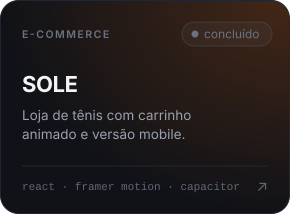
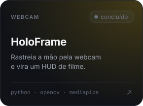
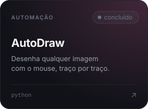

  

## projetos

  
  

  
  

  
  
  

  
  
  

## um pouco mais

Antes de programar eu trabalhei no CRAS, atendendo gente no balcão. Hoje cuido do administrativo e financeiro de uma OSC e programo no resto do tempo.

Foi isso que me fez gostar de sistema que resolve problema de verdade, porque do outro lado da tela sempre tem alguém esperando.

  
  

## contato

[LinkedIn](https://linkedin.com/in/lucasbrandaocabral) · [Instagram](https://instagram.com/lucasz.brandao) · [Discord](https://discord.com/users/lucasbrandaocabral)
