## oi, eu sou o Lucas

Dev full-stack da zona leste de SP. Gosto de interface bonita, animação que não trava e de pegar um processo chato e transformar em sistema.

De dia eu cuido do administrativo e financeiro de uma OSC. No resto do tempo tô programando alguma coisa, normalmente um projeto que ninguém pediu kk

Antes disso trabalhei no CRAS atendendo gente no balcão. Foi lá que eu entendi que todo sistema tem uma pessoa do outro lado da tela.

Hoje também faço sites e sistemas na [TuringDev](https://sejaturing.com.br) e na Olit, as agências que montei com meus sócios.

 

## minha coleção

11 cartas. Clica em uma pra abrir o projeto.

  
  <a href="https://github.com/Lucasbrandaocabral/pdfacrobat"></a>
  <a href="https://github.com/Lucasbrandaocabral/Pokedex"></a>

  <a href="https://maia-uniformes.vercel.app"></a>
  <a href="https://github.com/Lucasbrandaocabral/SOLE"></a>
  <a href="https://github.com/Lucasbrandaocabral/GeoFinder"></a>

  <a href="https://github.com/Lucasbrandaocabral/analisador-de-habitos"></a>
  <a href="https://github.com/Lucasbrandaocabral/HoloFrame"></a>
  <a href="https://github.com/Lucasbrandaocabral/Piano">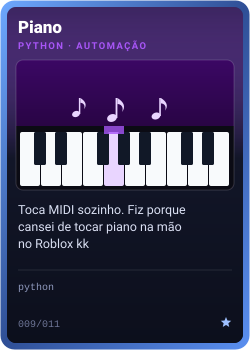</a>

  <a href="https://github.com/Lucasbrandaocabral/autodraw">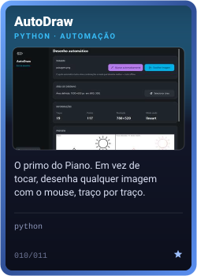</a>
  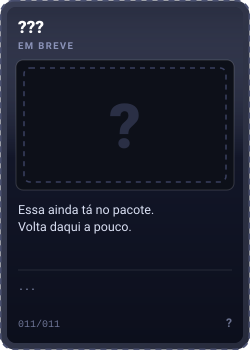

## meu deck

- **front:** React, TypeScript, Vite, Tailwind e Framer Motion
- **back:** Node, Express, Prisma, PostgreSQL e FastAPI
- **mobile:** Capacitor e Kotlin, no Android e no Wear OS
- **python:** OpenCV, MediaPipe e automação de tudo que dá pra automatizar
- **e o VBA**, que foi onde tudo começou

## números

  
  

## me chama

[LinkedIn](https://linkedin.com/in/lucasbrandaocabral) · [Instagram](https://instagram.com/lucasz.brandao) · [Discord](https://discord.com/users/lucasbrandaocabral)

Se curtiu alguma carta, deixa uma ⭐ no repositório dela. Pra mim é tipo abrir pacote.
